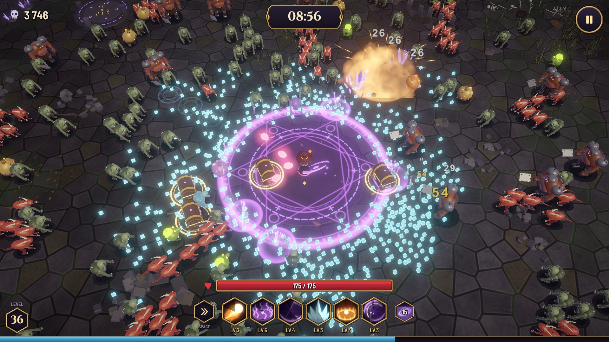
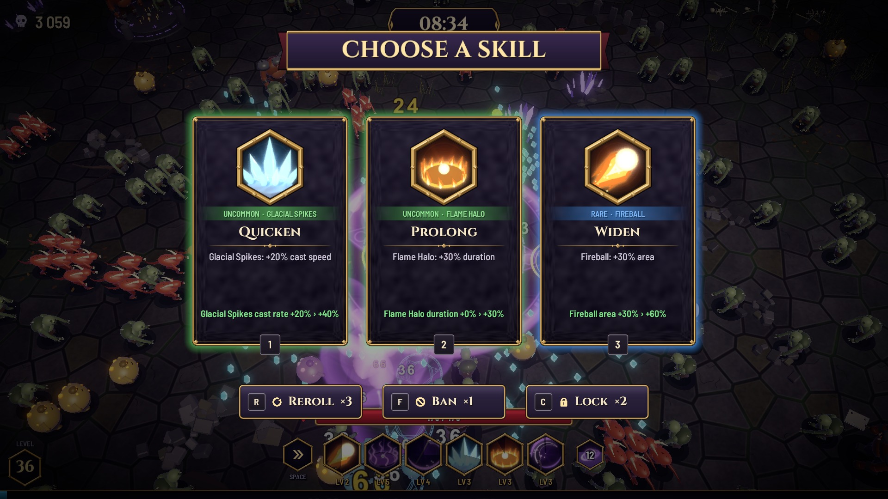

# HEXBORNE — Unity Gameplay Portfolio

A dark-fantasy magic survivor-like for web browsers. Choose a mage, survive a ten-minute run, combine fire, ice and shadow spells, and defeat the Hexlord before entering endless mode.

**[Play HEXBORNE on itch.io](https://serjikcod.itch.io/hexborne)** · [Screenshots](docs/screenshots.md) · [Architecture](docs/architecture.md)

**Stack:** C# · Unity 6000.6.0f1 · URP 17.7.0 · Extenject / Zenject · UniTask · DOTween · Input System 1.20.0 · uGUI · WebGL / IL2CPP

**Development workflow:** developed with AI assistance. These are actual project source files and documented technical decisions, not a claim that all code was written without AI.

## Start here

Three focused examples make the implementation easy to review:

| Example | What to inspect | Entry point |
| --- | --- | --- |
| Spatial queries for a horde | Counting-sort rebuild, fixed buffers, radius and nearest-target queries, cluster targeting | [SpatialGrid.cs](Samples/SpatialGrid.cs) · [guide](docs/spatial-grid.md) |
| Build-aware card offers | Eligibility, weighted rarity with fallback, no duplicate offers, bans and retained cards, injectable randomness | [CardRoller.cs](Samples/CardRoller.cs), [BuildState.cs](Samples/BuildState.cs) · [guide](docs/card-offers.md) |
| WebGL instancing | Fixed instance buckets, hidden padding, chunked draws and the cost of shader compilation | [InstancedBatch.cs](Samples/InstancedBatch.cs) · [case study](docs/web-performance.md) |

The nine production C# files and four existing test files are copied unchanged. [Source provenance](docs/source-manifest.json) records original paths and SHA-256 hashes. The [validation notes](docs/validation.md) explain which subset can be tested independently and which dependencies are outside this extract.

## Game loop

1. Choose the Ash Witch, Frost Seer or Reaper and enter the arena.
2. Move and dash while spells cast automatically; collect experience crystals.
3. Choose skills and upgrades whose availability follows the current build.
4. Combine Burn, Frost and Doom into Resonance reactions, Echo casts and elemental ultimates.
5. Fight elites and three bosses, then finish the run or continue in endless mode.
6. Spend soul shards on Altar upgrades and shape later runs with runes and curses.

The full game contains 12 spells, three elements, three skill forms, status reactions, build progression, boss telegraphs, persistent progression and keyboard, gamepad and touch controls. The selection below focuses on algorithms and browser performance.

Images are existing gameplay screenshots from the project's release marketing materials. They show the actual game, including a late-run arena and its card selection interface.

## Publication scope

This is a code-review portfolio extract. It contains selected source, tests, screenshots and technical notes. Scenes, prefabs, models, textures, audio, authored balance assets, portal integrations, builds and the full game's Git history are excluded. The repository does not reconstruct the game or compile as a complete Unity project.

Snapshot exported October 14, 2026 from source HEAD `fb4101f742021cdf1d1fda899dc4ee5c3bc1b878`; exact working-tree content is identified by the manifest hashes. Existing test files are published as review evidence; Unity tests were not run during this publication task.

## Suggested review topics

- Data layout and fixed-capacity buffers in the spatial index.
- Probability semantics when a rarity has no eligible cards.
- Separation of card eligibility, offer generation and card application.
- Small, injectable random interfaces for deterministic tests.
- WebGL shader compilation versus steady-state frame cost.
- Tradeoffs: bounded spatial coverage, padded GPU work and intentionally allocating offer-time collections.

Maintained by [@serjikcod4](https://github.com/serjikcod4). Related project: [Forgefall Portfolio](https://github.com/serjikcod4/Forgefall-Portfolio). See [NOTICE](NOTICE.md) for the publication and usage notice.
